# FIRST 10 — Technical Requirements Document (TRD)

**Principle:** a hybrid of small, specialized, inspectable components combined by a deterministic decision engine. No single giant model. No LLM in the decision path.

---

## 1. System architecture

```mermaid
flowchart LR
    SIM["Simulator / Stream Source"] --> ING["Ingestion API"]
    ING --> NORM["Normalizer: dedupe, revisions, quality flags"]
    NORM --> STORE[("PostgreSQL event store")]
    STORE --> WIN["Event-time windowing + replay"]
    WIN --> REL["Reliability and common-cause engine"]
    WIN --> CHG["Change detector"]
    REL --> INF["Bayesian inference engine"]
    CHG --> INF
    INF --> FC["Causal forecaster"]
    INF --> DEC["Decision engine: expected loss + stopping"]
    DEC --> CTRL["Action controller: hysteresis"]
    INF --> EXP["Explanation builder"]
    FC --> EXP
    CTRL --> EXP
    CTRL --> API["REST + WebSocket API"]
    FC --> API
    EXP --> API
    API --> UI["React dashboard"]
```



### Component responsibilities

| Component | Responsibility | Pure function? |
|-----------|----------------|----------------|
| Simulator | Seeded episode generation with ground truth and fault injection | Yes (seed in, events out) |
| Normalizer | Schema validation, dedupe by `event_id`, apply `revision_of`, quality flags | Yes |
| Windowing | Group by `event_time` minute; watermark; trigger recompute on late data | Stateful |
| Reliability engine | Source/group reliability, dependency discount, health observations | Yes given state |
| Change detector | Drift in observation distributions (ADWIN or BOCPD) | Stateful |
| Inference engine | Bayesian filter over H0..H3 | Yes |
| Forecaster | Causal-graph propagation to three events | Yes |
| Decision engine | Expected loss, value of waiting | Yes |
| Action controller | Hysteresis state machine | Stateful, deterministic |
| Explanation builder | Template-render from structured records | Yes |

## 2. Technology stack

| Layer | Choice | Notes |
|-------|--------|-------|
| Backend | Python 3.12, FastAPI, Pydantic v2 | Typed contracts |
| Numerics | NumPy, SciPy, pandas | Core math implemented explicitly rather than hidden in a library |
| Bayesian tooling | Hand-written filter; optional pgmpy for DBN prototyping | Hand-written is faster and easier to test |
| ML utilities | scikit-learn (Isolation Forest baseline, calibration, metrics), river or custom ADWIN | |
| Database | PostgreSQL 16 (TimescaleDB optional) | JSONB for flexible payloads |
| Streaming to client | WebSocket (FastAPI) | REST for config and history |
| Frontend | React 18, TypeScript, Vite, Tailwind, Recharts or visx, React Flow (graphs) | |
| State (client) | TanStack Query + Zustand | |
| Testing | pytest, hypothesis (property tests), Playwright | |
| Packaging | Docker Compose (api, db, web) | |

## 3. Data contracts

### 3.1 Event envelope
```json
{
  "event_id": "evt_01HZX...",
  "event_time": "2026-10-26T00:04:00Z",
  "ingestion_time": "2026-10-26T00:08:12Z",
  "source_id": "drain_A_017",
  "source_group": "gateway_G12",
  "location": {"lat": 19.07, "lon": 72.87, "zone": "A"},
  "event_type": "drainage_level",
  "value": {"level_cm": 82.0},
  "quality": "valid",
  "revision_of": null
}
```
`quality` ∈ {`valid`, `suspect`, `missing`, `corrected`, `retracted`}.
`event_type` ∈ {`rainfall`, `drainage_level`, `traffic_speed`, `road_closure`, `dispatch`, `hospital_arrivals`, `citizen_report`, `weather_alert`, `infra_status`, `source_heartbeat`}.

### 3.2 Per-minute assessment (core output)
```json
{
  "episode_id": "ep_...", "minute": 6, "assessment_version": 3,
  "belief": {"noise": 0.18, "sensor_failure": 0.25, "isolated": 0.15, "cascade": 0.42},
  "uncertainty": {"entropy_bits": 1.88, "effective_independent_sources": 4.2},
  "action": {
    "recommended": "PREPARE",
    "expected_cost": {"WATCH": 19.1, "PREPARE": 9.5, "ALERT": 9.9, "ESCALATE": 31.5},
    "wait_cost": 1.4, "next_review_minute": 7,
    "controller_state": "PREPARE", "transition_reason": "enter_prepare"
  },
  "forecast": [ {"event": "...", "area": "...", "window": [8, 10], "p": 0.55, "path": ["..."], "invalidated_if": ["..."]} ],
  "evidence": {"supporting": [], "contradicting": [], "discounted": [], "missing": []}
}
```
(Numbers shown are illustrative.)

## 4. Algorithms

### 4.1 Event-time processing
- Minute bucket = floor(`event_time`). Late events within `allowed_lateness` (default 15 simulated minutes) are accepted.
- Event store is append-only. A correction writes a new row with `revision_of`; the *effective view* picks the latest non-retracted revision per lineage.
- When a late/corrected event touches minute *m* ≤ current minute *t*, mark minutes *m..t* dirty and replay the filter from the belief snapshot at *m−1*. Result is stored as a new `assessment_version`; old versions remain for audit.
- Replay function: `infer(prev_belief, minute_evidence, params) -> belief` must be pure.

### 4.2 Bayesian filter
Hidden state H ∈ {0 noise, 1 sensor failure, 2 isolated, 3 cascade}.

```
predict:  b̃_t(h') = Σ_h  T[h, h'] · b_{t-1}(h)
update:   b_t(h')  ∝ b̃_t(h') · Π_g  L_g(E_g | h') ^ w_g
```
- `T` is a transition matrix with regime-specific priors (e.g. a monsoon regime raises background P(noise-with-anomalies)).
- Evidence is grouped into **dependency groups** `g` (shared gateway, shared reporter, duplicated incident). Each group contributes one likelihood term raised to a weight `w_g` (below), not one term per sensor.
- Likelihoods use robust distributions (Student-t / mixture with outlier component) to resist corrupted readings.
- Sensor-failure hypothesis likelihood explicitly models: simultaneous anomalies within one gateway, heartbeat loss, physically implausible values, and disagreement with independent sources.
- Missing observations contribute to **health likelihood** (supports H1 if concentrated in one dependency group) and *never* to "all clear."

### 4.3 Reliability and dependency discount
- Per source *i*: Beta(α_i, β_i) over reliability r_i; updated from verified outcomes.
- Group-level hierarchical prior: r_i ~ Beta(μ_g κ, (1−μ_g) κ), μ_g ~ Beta(a, b). A gateway failure moves μ_g, not each sensor independently.
- Effective sample size for n correlated sources with intra-group correlation ρ:
  `n_eff = n / (1 + (n − 1) ρ)`.
  Group weight `w_g = n_eff · r̄_g` applied to the mean log-likelihood-ratio of the group.
- Dependency graph: nodes = sources, gateways, networks, reporters; edges = "depends on". ρ estimated from co-failure rate (heartbeat loss, simultaneous anomaly onset) and prior config.
- Caveat enforced in UI: reliability estimates carry uncertainty; without ground truth they stay near the prior.

### 4.4 Citizen-report and rumor handling
1. Cluster by text similarity (TF-IDF cosine or sentence embeddings), location radius and time window.
2. Identical media hash or near-identical text counts as one provenance unit.
3. Compute independence score from distinct origins, plausible geography, and agreement with physical sensors/dispatch.
4. Weight: `w = base · independence · plausibility`. Uncorroborated reports stay as uncertain evidence, not as "false."

### 4.5 Decision engine
Cost matrix `C[a, h]` (versioned, editable). Illustrative starting values (to be tuned/justified, not "optimal"):

| Action \ Truth | Noise | Sensor fail | Isolated | Cascade |
|----------------|------:|------------:|---------:|--------:|
| WATCH | 0 | 1 | 15 | 100 |
| PREPARE | 2 | 3 | 8 | 40 |
| ALERT | 10 | 12 | 4 | 15 |
| ESCALATE | 40 | 45 | 20 | 5 |

Expected loss: `EL(a) = Σ_h b_t(h) C[a, h]`; candidate `a* = argmin EL(a)`.

**Value of waiting (one-step preposterior):**
```
E_next = Σ_{e'} P(e' | b_t) · min_a EL_{b_t+1(e')}(a)
VoW    = EL(a*) − (E_next + D(b_t))
```
`D(b)` = expected delay damage per minute = Σ_h b(h)·d(h), with `d(H3)` largest. Predictive distribution over `e'` is a coarse discretization (e.g. {no change, independent confirmation, contradicting evidence, further source loss}) produced by the same observation model. If VoW > 0, hold the least costly *non-terminal* action (WATCH/PREPARE) and gather evidence; otherwise commit to `a*`.

### 4.6 Action controller (hysteresis)
States: WATCH → PREPARE → ALERT → ESCALATE.
- **Enter** state *s* when EL(s) is lower than EL(current) by margin `m_up(s)`.
- **Leave** (de-escalate) only if EL(lower) beats EL(current) by margin `m_down` for `k` consecutive minutes.
- **Override**: if P(cascade) ≥ `p_override` supported by ≥ `n_ind` independent groups, escalate immediately, bypassing timers.
- Escalations are never delayed by persistence timers.
- Every transition writes `transition_reason` plus evidence IDs.
- Margins and `k` are tuned on the simulated suite using the cost model, not chosen to make charts look calm.

### 4.7 Causal forecaster
- Graph G = (nodes = event types × areas, edges = causal links). Each edge has `p_edge` and a delay distribution (Gamma or log-normal).
- Seed probability of each upstream node from observed evidence and current belief (condition on hypothesis: forecast = Σ_h b(h) · forecast_h).
- Propagate: `P(child by window) = Σ_parents P(parent) · p_edge · P(delay ∈ window)`. Use noisy-OR for multiple parents.
- Rank candidates by `P · impact`, enforce diversity (distinct subsystems), return top 3.
- Each result stores the causal path, supporting evidence IDs and invalidation conditions (e.g. "gateway G-12 confirmed faulty").
- **Abstain** per slot when supporting independent groups < threshold or P < floor.
- Optional upgrade: replace edge delay models with survival models fitted on simulated data.

### 4.8 Adaptation
| Shift type | Mechanism | Guard |
|------------|-----------|-------|
| Prior (base rate) | Online Beta/Dirichlet update of regime priors from *verified* outcomes; regime flag (e.g. monsoon) | Never learn from unverified rumor bursts |
| Source | Per-source and per-group reliability updates | Group-aware so one gateway doesn't poison all |
| Relationship | Requires sustained evidence; manual approval to change causal parameters | Prevents desensitization to real floods |

ADWIN/BOCPD raises a *change flag*; context (season, source health) decides which of the three shifts it is.

### 4.9 Calibration
Evaluate with held-out simulated episodes. Apply temperature scaling or isotonic calibration on the **likelihood scale** only if reliability diagrams show systematic miscalibration. Report ECE with bootstrap CIs.

### 4.10 Twin Test implementation
- `twin_pair` = two episodes sharing seed prefix up to split minute *s*.
- Assertions:
  1. Event streams equal for minutes ≤ s (hash compare).
  2. Beliefs and actions equal for minutes ≤ s (determinism).
  3. **Prefix-ensemble calibration:** across N episodes with the same prefix class, mean predicted P(cascade) at *s* ≈ empirical fraction that became cascades.
  4. After *s*, time to justified action measured from first discriminative event.

## 5. API specification

### REST (all under `/api/v1`)
| Method | Path | Purpose | Roles |
|--------|------|---------|-------|
| POST | `/auth/login` `/auth/refresh` `/auth/logout` | Session | any |
| GET | `/episodes` | List | viewer+ |
| POST | `/episodes` | Create from scenario + seed | analyst+ |
| POST | `/episodes/{id}/start` `/pause` `/step` `/reset` | Control playback | duty_officer+ |
| GET | `/episodes/{id}/assessments?from=&to=` | Belief/action/forecast history | viewer+ |
| GET | `/episodes/{id}/assessments/{minute}/versions` | Audit across replays | viewer+ |
| GET | `/episodes/{id}/events` | Event lineage view | viewer+ |
| GET | `/episodes/{id}/sources` | Source health + dependency graph | viewer+ |
| POST | `/episodes/{id}/faults` | Inject fault | analyst+ |
| POST | `/twin-tests` | Create twin pair | analyst+ |
| GET | `/twin-tests/{id}/compare` | Side-by-side outputs + metrics | analyst+ |
| POST | `/eval-runs` | Run suite | analyst+ |
| GET | `/eval-runs/{id}` | Metrics | analyst+ |
| GET/PUT | `/config/cost-matrix` `/config/causal-graph` `/config/dependencies` | Versioned config | admin |
| POST | `/authorizations` | Request ESCALATE/ALERT authorization | duty_officer |
| POST | `/authorizations/{id}/decision` | Approve/reject | supervisor |
| GET | `/audit` | Immutable audit log | supervisor+ |

### WebSocket `/ws/episodes/{id}`
Server → client messages: `tick` (new assessment), `revision` (replayed minute with new version), `source_health`, `fault_injected`, `authorization_update`. Client → server: `subscribe`, `ping`. Connection requires a one-time ticket (see authflow).

## 6. Determinism and reproducibility
- All randomness from a seeded `numpy.random.Generator`; seed stored per episode.
- No wall-clock in inference. Simulated clock only.
- Config (cost matrix, graph, transition matrix, params) hashed into `config_hash`; stored with every assessment.
- Sorted processing key: `(event_time, source_id, event_id)`.

## 7. Performance targets
- 500 sources × 1 reading/min ≈ 500 events/min; tick budget < 500 ms.
- Replay of 60 minutes < 5 s.
- Dashboard updates < 200 ms after server tick.

## 8. Testing strategy
| Level | Examples |
|-------|----------|
| Unit | Bayes update on hand-computed cases; `n_eff` formula; cost argmin; hysteresis transitions |
| Property (hypothesis) | Belief sums to 1; duplicate events never change belief; permuted arrival order with same event times yields same final belief |
| Scenario | Ten scenarios from the PRD test table |
| Twin | Prefix equality, ensemble calibration |
| Fault | Gateway kill: no escalation caused solely by failed group; camera loss: no "roads clear" inference |
| Regression | Golden-file assessments per seed |
| E2E | Playwright: login, run twin, request and approve ESCALATE |

## 9. Observability
Structured JSON logs with `episode_id`, `minute`, `assessment_version`, `config_hash`. Metrics: tick latency, replay count, late-event rate, dropped-duplicate count.

## 10. Deployment
Docker Compose: `api`, `worker` (episode runner), `db`, `web`. Single environment for the prototype; environment variables for secrets (see authflow).

## 11. Limitations (to state openly)
- Evaluated on simulated data only; not validated for real deployment.
- Cost matrix values are scenario assumptions.
- Reliability learning without ground truth stays near priors by design.
