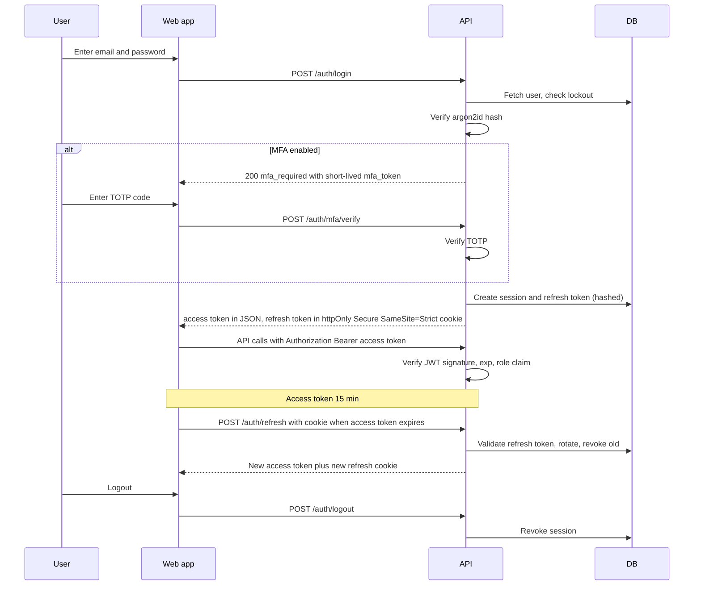
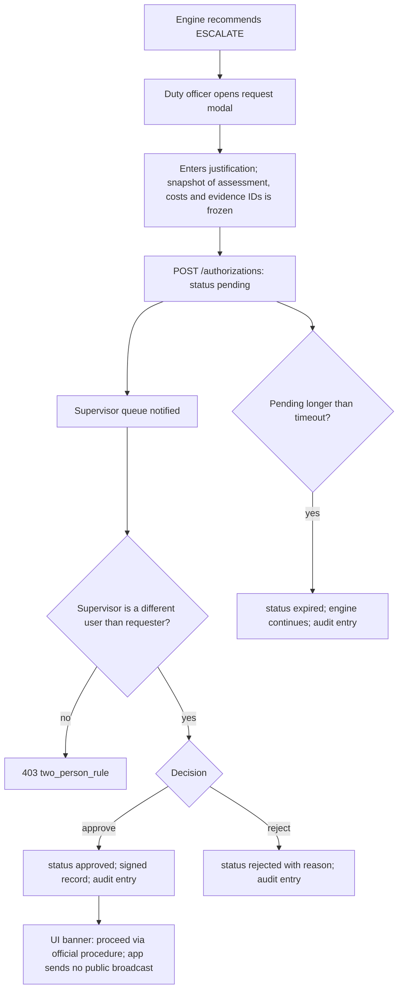

# FIRST 10 — Auth Flow

Scope: authentication, session handling, role-based access, WebSocket auth and the human-authorization workflow for consequential recommendations. The prototype runs on simulated data, but the design is production-minded.

## 1. Roles and permissions

| Role | Description |
|------|-------------|
| `viewer` | Read-only dashboard and audit |
| `duty_officer` | Controls playback, requests authorization |
| `supervisor` | Approves or rejects authorization requests, reads audit |
| `analyst` | Simulation Lab, fault injection, evaluation runs |
| `admin` | All of the above plus config and user management |

| Permission | viewer | duty_officer | supervisor | analyst | admin |
|-----------|:-----:|:-----------:|:---------:|:------:|:----:|
| `episode:read` | ✔ | ✔ | ✔ | ✔ | ✔ |
| `episode:control` | | ✔ | ✔ | ✔ | ✔ |
| `episode:create` | | | | ✔ | ✔ |
| `fault:inject` | | | | ✔ | ✔ |
| `eval:run` | | | | ✔ | ✔ |
| `auth_request:create` | | ✔ | ✔ | | |
| `auth_request:decide` | | | ✔ | | |
| `audit:read` | | | ✔ | ✔ | ✔ |
| `config:write` | | | | | ✔ |
| `user:manage` | | | | | ✔ |

A user holds one primary role (extendable to multiple via `user_roles`).

## 2. Login and session flow



## 3. Token design

| Token | Format | Lifetime | Storage |
|-------|--------|----------|---------|
| Access | JWT (EdDSA or RS256) with `sub`, `role`, `sid`, `iat`, `exp` | 15 min | Memory only (not localStorage) |
| Refresh | Opaque random 256-bit, stored as SHA-256 hash | 7 days, rotating | httpOnly Secure SameSite=Strict cookie |
| MFA challenge | Opaque, single use | 5 min | Memory |
| WS ticket | Opaque, single use | 30 s | Memory |
| Judge link | Signed JWT scoped to one sandbox episode, read-only | Set by admin (e.g. 24 h) | URL fragment |

**Refresh reuse detection:** if a rotated refresh token is presented again, revoke the entire session family and force re-login.

## 4. WebSocket authentication

```mermaid
sequenceDiagram
    participant W as Web app
    participant A as API
    W->>A: POST /auth/ws-ticket with access token and episode_id
    A->>A: Check episode:read permission
    A-->>W: One-time ticket valid 30 s
    W->>A: Open WS /ws/episodes/id?ticket=...
    A->>A: Consume ticket, bind connection to user and episode
    A-->>W: Connection established
    Note over W,A: On access token expiry the server keeps the socket; on session revocation the server closes it
```
Server periodically checks session validity (every 60 s) and closes sockets whose session is revoked.

## 5. Human authorization flow (ESCALATE / ALERT)



Rules:
- The app records and exports authorization (for example a CAP-style JSON stub). It **never** broadcasts publicly.
- Approval is bound to the frozen snapshot (assessment version + config hash). If the assessment materially changes before approval, the supervisor sees a "stale snapshot" warning.
- Expiry default: 5 simulated minutes (configurable).

## 6. Authorization middleware

```
request → rate limiter → JWT verify → load session (revoked?) → permission check → handler → audit log (for mutating or sensitive routes)
```
Permissions are enforced server-side with a decorator such as `@require("auth_request:decide")`; the UI hides controls but is never the source of truth.

## 7. Security controls

| Area | Control |
|------|---------|
| Passwords | argon2id, min 12 chars, breach-list check optional |
| Lockout | 5 failed attempts → 15 min lock, exponential backoff, generic error messages |
| MFA | TOTP optional for duty_officer, required for supervisor and admin |
| CSRF | SameSite=Strict refresh cookie; refresh and logout endpoints also require a custom header |
| CORS | Allow-list of web origin only |
| Rate limits | Login 10/min/IP; API 120/min/user; fault injection 30/min |
| Transport | HTTPS only; HSTS |
| Secrets | Env vars / secret manager; JWT keys rotated with `kid` |
| Input | Pydantic validation; size limits on ingestion |
| Audit | Append-only `audit_log` with hash chain (each row stores hash of previous) |
| Data | Prototype data is synthetic; no personal data from citizen reports is stored beyond synthetic text |
| Sandbox | Judge links see only sandbox episodes; no config or user access |

## 8. Demo accounts (seed data, prototype only)

| Email | Role |
|-------|------|
| officer@demo.first10 | duty_officer |
| supervisor@demo.first10 | supervisor |
| analyst@demo.first10 | analyst |
| admin@demo.first10 | admin |
| judge-link | viewer + analyst (sandbox only) |

Passwords are generated at seed time and printed once to the console; never committed.

## 9. Error responses
`401 invalid_credentials | token_expired | session_revoked`, `403 forbidden | two_person_rule`, `423 account_locked`, `429 rate_limited`. Responses never reveal whether an email exists.
