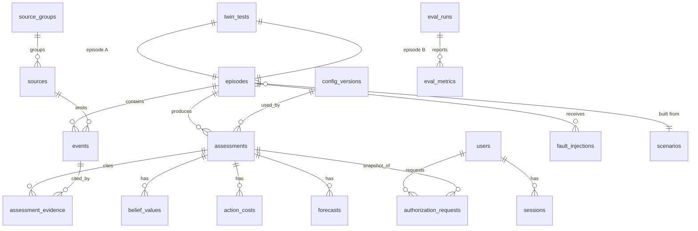

# FIRST 10 — Backend Schema (PostgreSQL 16)

Design rules:
- **Append-only** for events, assessments and audit. Corrections add rows; nothing is overwritten.
- Every assessment stores `assessment_version` and `config_hash` so any number on screen is reproducible.
- Event-time (`event_time`) and arrival time (`ingestion_time`) are separate columns.

## 1. Entity overview



## 2. DDL

```sql
CREATE EXTENSION IF NOT EXISTS pgcrypto;

-- ===== Identity =====
CREATE TYPE user_role AS ENUM ('viewer','duty_officer','supervisor','analyst','admin');

CREATE TABLE users (
  id             UUID PRIMARY KEY DEFAULT gen_random_uuid(),
  email          CITEXT UNIQUE NOT NULL,
  password_hash  TEXT NOT NULL,
  display_name   TEXT NOT NULL,
  role           user_role NOT NULL,
  mfa_secret_enc BYTEA,
  mfa_enabled    BOOLEAN NOT NULL DEFAULT FALSE,
  failed_logins  INT NOT NULL DEFAULT 0,
  locked_until   TIMESTAMPTZ,
  is_active      BOOLEAN NOT NULL DEFAULT TRUE,
  created_at     TIMESTAMPTZ NOT NULL DEFAULT now()
);

CREATE TABLE sessions (
  id              UUID PRIMARY KEY DEFAULT gen_random_uuid(),
  user_id         UUID NOT NULL REFERENCES users(id) ON DELETE CASCADE,
  family_id       UUID NOT NULL,              -- refresh-token family for reuse detection
  refresh_hash    BYTEA NOT NULL,             -- SHA-256 of opaque token
  user_agent      TEXT,
  ip_address      INET,
  created_at      TIMESTAMPTZ NOT NULL DEFAULT now(),
  expires_at      TIMESTAMPTZ NOT NULL,
  revoked_at      TIMESTAMPTZ,
  replaced_by     UUID REFERENCES sessions(id)
);
CREATE INDEX ON sessions(user_id);
CREATE INDEX ON sessions(family_id);

CREATE TABLE ws_tickets (
  ticket_hash BYTEA PRIMARY KEY,
  user_id     UUID NOT NULL REFERENCES users(id),
  episode_id  UUID NOT NULL,
  expires_at  TIMESTAMPTZ NOT NULL,
  used_at     TIMESTAMPTZ
);

-- ===== Configuration (versioned) =====
CREATE TABLE config_versions (
  id           UUID PRIMARY KEY DEFAULT gen_random_uuid(),
  config_hash  TEXT UNIQUE NOT NULL,
  kind         TEXT NOT NULL CHECK (kind IN ('bundle')),
  cost_matrix  JSONB NOT NULL,       -- {action: {hypothesis: cost}}
  delay_rates  JSONB NOT NULL,       -- d(h) per minute
  transition   JSONB NOT NULL,       -- 4x4 matrix per regime
  params       JSONB NOT NULL,       -- margins, k, p_override, allowed_lateness, etc.
  created_by   UUID REFERENCES users(id),
  created_at   TIMESTAMPTZ NOT NULL DEFAULT now(),
  note         TEXT
);

CREATE TABLE causal_graphs (
  id          UUID PRIMARY KEY DEFAULT gen_random_uuid(),
  version     INT NOT NULL,
  is_active   BOOLEAN NOT NULL DEFAULT FALSE,
  created_at  TIMESTAMPTZ NOT NULL DEFAULT now()
);
CREATE TABLE causal_nodes (
  id          UUID PRIMARY KEY DEFAULT gen_random_uuid(),
  graph_id    UUID NOT NULL REFERENCES causal_graphs(id) ON DELETE CASCADE,
  key         TEXT NOT NULL,                -- e.g. 'drainage_overflow'
  label       TEXT NOT NULL,
  subsystem   TEXT NOT NULL,                -- for diversity ranking
  impact      NUMERIC NOT NULL DEFAULT 1,
  UNIQUE (graph_id, key)
);
CREATE TABLE causal_edges (
  id            UUID PRIMARY KEY DEFAULT gen_random_uuid(),
  graph_id      UUID NOT NULL REFERENCES causal_graphs(id) ON DELETE CASCADE,
  parent_key    TEXT NOT NULL,
  child_key     TEXT NOT NULL,
  p_edge        NUMERIC NOT NULL CHECK (p_edge BETWEEN 0 AND 1),
  delay_dist    TEXT NOT NULL CHECK (delay_dist IN ('gamma','lognormal')),
  delay_params  JSONB NOT NULL
);

-- ===== Sources and dependencies =====
CREATE TABLE source_groups (
  id          UUID PRIMARY KEY DEFAULT gen_random_uuid(),
  code        TEXT UNIQUE NOT NULL,         -- 'gateway_G12'
  kind        TEXT NOT NULL CHECK (kind IN ('gateway','network','organization','reporter_cluster')),
  prior_corr  NUMERIC NOT NULL DEFAULT 0.5 CHECK (prior_corr BETWEEN 0 AND 1)
);

CREATE TABLE sources (
  id               UUID PRIMARY KEY DEFAULT gen_random_uuid(),
  code             TEXT UNIQUE NOT NULL,    -- 'drain_A_017'
  type             TEXT NOT NULL,           -- event_type family
  group_id         UUID REFERENCES source_groups(id),
  zone             TEXT,
  lat              DOUBLE PRECISION,
  lon              DOUBLE PRECISION,
  expected_period_s INT,                     -- expected reporting frequency
  alpha            NUMERIC NOT NULL DEFAULT 2,  -- Beta prior
  beta             NUMERIC NOT NULL DEFAULT 1
);
CREATE INDEX ON sources(group_id);

CREATE TABLE source_dependencies (
  source_id     UUID NOT NULL REFERENCES sources(id) ON DELETE CASCADE,
  depends_on_id UUID NOT NULL REFERENCES source_groups(id) ON DELETE CASCADE,
  strength      NUMERIC NOT NULL DEFAULT 1,
  PRIMARY KEY (source_id, depends_on_id)
);

-- ===== Scenarios, episodes, twins =====
CREATE TABLE scenarios (
  id          UUID PRIMARY KEY DEFAULT gen_random_uuid(),
  code        TEXT UNIQUE NOT NULL,         -- 'gateway_failure', 'real_cascade', 'monsoon_shift'
  description TEXT,
  generator   JSONB NOT NULL                -- generator parameters
);

CREATE TYPE ground_truth AS ENUM ('noise','sensor_failure','isolated','cascade');
CREATE TYPE episode_status AS ENUM ('created','running','paused','finished');

CREATE TABLE episodes (
  id            UUID PRIMARY KEY DEFAULT gen_random_uuid(),
  scenario_id   UUID REFERENCES scenarios(id),
  seed          BIGINT NOT NULL,
  config_hash   TEXT NOT NULL REFERENCES config_versions(config_hash),
  graph_id      UUID REFERENCES causal_graphs(id),
  status        episode_status NOT NULL DEFAULT 'created',
  current_minute INT NOT NULL DEFAULT 0,
  duration_min  INT NOT NULL DEFAULT 30,
  truth         ground_truth,               -- hidden from non-analyst API responses
  is_sandbox    BOOLEAN NOT NULL DEFAULT FALSE,
  created_by    UUID REFERENCES users(id),
  created_at    TIMESTAMPTZ NOT NULL DEFAULT now()
);

CREATE TABLE twin_tests (
  id            UUID PRIMARY KEY DEFAULT gen_random_uuid(),
  episode_a     UUID NOT NULL REFERENCES episodes(id),
  episode_b     UUID NOT NULL REFERENCES episodes(id),
  split_minute  INT NOT NULL,
  prefix_hash   TEXT NOT NULL,              -- hash of events <= split
  created_at    TIMESTAMPTZ NOT NULL DEFAULT now()
);

-- ===== Events (append-only, idempotent) =====
CREATE TYPE event_quality AS ENUM ('valid','suspect','missing','corrected','retracted');

CREATE TABLE events (
  pk              BIGSERIAL PRIMARY KEY,
  episode_id      UUID NOT NULL REFERENCES episodes(id) ON DELETE CASCADE,
  event_id        TEXT NOT NULL,
  event_time      TIMESTAMPTZ NOT NULL,
  sim_minute      INT NOT NULL,             -- floor of event_time in sim clock
  ingestion_time  TIMESTAMPTZ NOT NULL,
  ingest_minute   INT NOT NULL,
  source_id       UUID REFERENCES sources(id),
  source_group_id UUID REFERENCES source_groups(id),
  zone            TEXT,
  lat             DOUBLE PRECISION,
  lon             DOUBLE PRECISION,
  event_type      TEXT NOT NULL,
  value           JSONB NOT NULL,
  quality         event_quality NOT NULL DEFAULT 'valid',
  revision_of     TEXT,                     -- event_id of the earlier event
  content_hash    TEXT,                     -- for text/media near-duplicate detection
  UNIQUE (episode_id, event_id)             -- idempotency
);
CREATE INDEX ON events (episode_id, sim_minute);
CREATE INDEX ON events (episode_id, source_group_id, sim_minute);
CREATE INDEX ON events (episode_id, revision_of);

-- Effective view: latest non-retracted revision per lineage
CREATE VIEW events_effective AS
SELECT e.*
FROM events e
WHERE e.quality <> 'retracted'
  AND NOT EXISTS (
    SELECT 1 FROM events r
    WHERE r.episode_id = e.episode_id AND r.revision_of = e.event_id
  );

CREATE TABLE dead_letter_events (
  id         BIGSERIAL PRIMARY KEY,
  episode_id UUID,
  payload    JSONB NOT NULL,
  reason     TEXT NOT NULL,
  received_at TIMESTAMPTZ NOT NULL DEFAULT now()
);

-- ===== Assessments (per minute, versioned) =====
CREATE TABLE assessments (
  id                 UUID PRIMARY KEY DEFAULT gen_random_uuid(),
  episode_id         UUID NOT NULL REFERENCES episodes(id) ON DELETE CASCADE,
  minute             INT NOT NULL,
  assessment_version INT NOT NULL,
  is_current         BOOLEAN NOT NULL DEFAULT TRUE,
  config_hash        TEXT NOT NULL REFERENCES config_versions(config_hash),
  entropy_bits       NUMERIC NOT NULL,
  effective_sources  NUMERIC NOT NULL,
  recommended_action TEXT NOT NULL CHECK (recommended_action IN ('WATCH','PREPARE','ALERT','ESCALATE')),
  controller_state   TEXT NOT NULL,
  transition_reason  TEXT NOT NULL,
  wait_cost          NUMERIC,
  vow                NUMERIC,                -- value of waiting
  next_review_minute INT,
  override_triggered BOOLEAN NOT NULL DEFAULT FALSE,
  trigger_cause      TEXT,                   -- 'on_time','late_event','correction','retraction'
  explanation        JSONB NOT NULL,         -- structured: new evidence, belief change, why action, what would change it
  computed_at        TIMESTAMPTZ NOT NULL DEFAULT now(),
  UNIQUE (episode_id, minute, assessment_version)
);
CREATE UNIQUE INDEX one_current_per_minute ON assessments(episode_id, minute) WHERE is_current;

CREATE TABLE belief_values (
  assessment_id UUID NOT NULL REFERENCES assessments(id) ON DELETE CASCADE,
  hypothesis    ground_truth NOT NULL,
  probability   NUMERIC NOT NULL CHECK (probability BETWEEN 0 AND 1),
  PRIMARY KEY (assessment_id, hypothesis)
);

CREATE TABLE action_costs (
  assessment_id UUID NOT NULL REFERENCES assessments(id) ON DELETE CASCADE,
  action        TEXT NOT NULL CHECK (action IN ('WATCH','PREPARE','ALERT','ESCALATE')),
  expected_cost NUMERIC NOT NULL,
  PRIMARY KEY (assessment_id, action)
);

CREATE TABLE forecasts (
  id            UUID PRIMARY KEY DEFAULT gen_random_uuid(),
  assessment_id UUID NOT NULL REFERENCES assessments(id) ON DELETE CASCADE,
  slot          INT NOT NULL CHECK (slot BETWEEN 1 AND 3),
  available     BOOLEAN NOT NULL,
  node_key      TEXT,
  area          TEXT,
  window_start  INT,
  window_end    INT,
  probability   NUMERIC CHECK (probability BETWEEN 0 AND 1),
  causal_path   JSONB,
  invalidated_if JSONB,
  unavailable_reason TEXT,
  UNIQUE (assessment_id, slot)
);

CREATE TYPE evidence_role AS ENUM ('supporting','contradicting','discounted','missing');
CREATE TABLE assessment_evidence (
  assessment_id UUID NOT NULL REFERENCES assessments(id) ON DELETE CASCADE,
  event_pk      BIGINT REFERENCES events(pk),
  group_id      UUID REFERENCES source_groups(id),
  hypothesis    ground_truth,
  role          evidence_role NOT NULL,
  log_lr        NUMERIC,                    -- contribution before discount
  weight        NUMERIC,                    -- after n_eff and reliability
  note          TEXT
);
CREATE INDEX ON assessment_evidence(assessment_id);

CREATE TABLE source_reliability_snapshots (
  id            BIGSERIAL PRIMARY KEY,
  episode_id    UUID NOT NULL REFERENCES episodes(id) ON DELETE CASCADE,
  minute        INT NOT NULL,
  source_id     UUID REFERENCES sources(id),
  group_id      UUID REFERENCES source_groups(id),
  alpha         NUMERIC NOT NULL,
  beta          NUMERIC NOT NULL,
  health        TEXT NOT NULL CHECK (health IN ('ok','stale','missing','suspect','failed')),
  n_eff         NUMERIC,
  rho           NUMERIC
);
CREATE INDEX ON source_reliability_snapshots(episode_id, minute);

CREATE TABLE regime_priors (
  id          UUID PRIMARY KEY DEFAULT gen_random_uuid(),
  regime      TEXT NOT NULL,                -- 'baseline','monsoon'
  prior       JSONB NOT NULL,               -- Dirichlet over 4 hypotheses
  updated_at  TIMESTAMPTZ NOT NULL DEFAULT now()
);

CREATE TABLE change_flags (
  id          BIGSERIAL PRIMARY KEY,
  episode_id  UUID NOT NULL REFERENCES episodes(id) ON DELETE CASCADE,
  minute      INT NOT NULL,
  detector    TEXT NOT NULL,
  stream      TEXT NOT NULL,
  interpretation TEXT CHECK (interpretation IN ('prior_shift','source_shift','relationship_shift','unknown'))
);

-- ===== Fault injection =====
CREATE TABLE fault_injections (
  id          UUID PRIMARY KEY DEFAULT gen_random_uuid(),
  episode_id  UUID NOT NULL REFERENCES episodes(id) ON DELETE CASCADE,
  fault_type  TEXT NOT NULL CHECK (fault_type IN
              ('gateway_down','camera_loss','duplicates','out_of_order','late_dispatch',
               'retraction','rumor_burst','story_changing_source')),
  target      JSONB NOT NULL,
  start_minute INT NOT NULL,
  end_minute   INT,
  injected_by UUID REFERENCES users(id),
  created_at  TIMESTAMPTZ NOT NULL DEFAULT now()
);

-- ===== Human authorization =====
CREATE TYPE auth_status AS ENUM ('pending','approved','rejected','expired');
CREATE TABLE authorization_requests (
  id              UUID PRIMARY KEY DEFAULT gen_random_uuid(),
  episode_id      UUID NOT NULL REFERENCES episodes(id),
  assessment_id   UUID NOT NULL REFERENCES assessments(id),   -- frozen snapshot
  action          TEXT NOT NULL CHECK (action IN ('ALERT','ESCALATE')),
  requested_by    UUID NOT NULL REFERENCES users(id),
  justification   TEXT NOT NULL,
  status          auth_status NOT NULL DEFAULT 'pending',
  decided_by      UUID REFERENCES users(id),
  decision_reason TEXT,
  created_at      TIMESTAMPTZ NOT NULL DEFAULT now(),
  decided_at      TIMESTAMPTZ,
  expires_at      TIMESTAMPTZ NOT NULL,
  CHECK (decided_by IS NULL OR decided_by <> requested_by)   -- two-person rule
);

-- ===== Evaluation =====
CREATE TABLE eval_runs (
  id            UUID PRIMARY KEY DEFAULT gen_random_uuid(),
  suite         TEXT NOT NULL,
  config_hash   TEXT NOT NULL REFERENCES config_versions(config_hash),
  n_episodes    INT NOT NULL,
  seed_start    BIGINT NOT NULL,
  started_at    TIMESTAMPTZ NOT NULL DEFAULT now(),
  finished_at   TIMESTAMPTZ,
  started_by    UUID REFERENCES users(id)
);
CREATE TABLE eval_metrics (
  id          BIGSERIAL PRIMARY KEY,
  eval_run_id UUID NOT NULL REFERENCES eval_runs(id) ON DELETE CASCADE,
  scenario    TEXT,
  metric      TEXT NOT NULL,                -- 'brier','log_loss','ece','total_cost','false_escalations',
                                            -- 'time_to_action','reversals','forecast_coverage','twin_prefix_equal'
  value       NUMERIC NOT NULL,
  ci_low      NUMERIC,
  ci_high     NUMERIC
);
CREATE TABLE calibration_bins (
  eval_run_id UUID NOT NULL REFERENCES eval_runs(id) ON DELETE CASCADE,
  hypothesis  ground_truth NOT NULL,
  bin_index   INT NOT NULL,
  mean_pred   NUMERIC NOT NULL,
  frac_true   NUMERIC NOT NULL,
  n           INT NOT NULL,
  PRIMARY KEY (eval_run_id, hypothesis, bin_index)
);

-- ===== Audit (append-only, hash-chained) =====
CREATE TABLE audit_log (
  id          BIGSERIAL PRIMARY KEY,
  at          TIMESTAMPTZ NOT NULL DEFAULT now(),
  actor_id    UUID REFERENCES users(id),
  action      TEXT NOT NULL,                -- 'login','config_change','fault_inject','auth_request','auth_decision', ...
  entity      TEXT,
  entity_id   TEXT,
  detail      JSONB,
  prev_hash   BYTEA,
  row_hash    BYTEA NOT NULL
);
REVOKE UPDATE, DELETE ON audit_log FROM PUBLIC;
```

## 3. Key queries

**Latest belief for a minute**
```sql
SELECT b.hypothesis, b.probability
FROM assessments a JOIN belief_values b ON b.assessment_id = a.id
WHERE a.episode_id = $1 AND a.minute = $2 AND a.is_current;
```

**Minutes revised by late data**
```sql
SELECT minute, MAX(assessment_version) AS latest_version, array_agg(DISTINCT trigger_cause)
FROM assessments WHERE episode_id = $1 GROUP BY minute HAVING MAX(assessment_version) > 1;
```

**Replay write pattern (one transaction)**
1. `UPDATE assessments SET is_current = FALSE WHERE episode_id=$1 AND minute BETWEEN $m AND $t AND is_current`
2. Insert new assessments with `assessment_version = previous + 1`, plus child rows.

**Common-cause detection input**
```sql
SELECT source_group_id, sim_minute, count(*) FILTER (WHERE quality='missing') AS missing,
       count(*) AS total
FROM events WHERE episode_id=$1 AND sim_minute BETWEEN $2 AND $3
GROUP BY source_group_id, sim_minute;
```

## 4. Retention and integrity
- Events, assessments and audit never deleted in the prototype; episodes can be archived.
- Foreign keys everywhere possible; `config_hash` ties outputs to exact parameters.
- `truth` column excluded from all API responses except analyst/admin, and hidden in the live dashboard during an episode to avoid leaking ground truth.
- Migrations via Alembic; seed script creates demo users, sources, gateways, causal graph v1, cost matrix v1.
