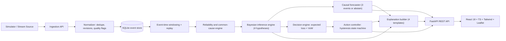

# FIRST 10 — Uncertainty-Aware Crisis Inference & Decision Engine

> **SIMULATED DATA — not for real emergency decisions**

FIRST 10 helps a city duty officer decide, minute by minute, whether an emerging situation is noise, a sensor failure, an isolated incident, or a cascading crisis, and what to do about it *before* the evidence is conclusive.

---

## 1. System Architecture



---

## 2. Quickstart & Run Commands

### Backend (FastAPI, Port 8000)
```powershell
# 1. Activate venv
.\backend\venv\Scripts\Activate.ps1

# 2. Seed demo episodes
python -m app.seed

# 3. Start server
python -m uvicorn app.main:app --host 0.0.0.0 --port 8000 --reload
```

### Frontend (React + Vite, Port 5173)
```powershell
cd frontend
npm install
npm run dev -- --port 5173
```
Open **[http://localhost:5173](http://localhost:5173)** in your browser.

### Run Test Suite (All 10 Plan Tests)
```powershell
.\backend\venv\Scripts\pytest.exe -v
```

---

## 3. Demo Accounts

| Role | Email | Password | Permissions |
|---|---|---|---|
| **Duty Officer** | `officer@demo.first10` | `password123` | Control playback, request consequential action |
| **Supervisor** | `supervisor@demo.first10` | `password123` | Approve / Reject authorization (Two-Person Rule) |
| **Analyst** | `analyst@demo.first10` | `password123` | Simulation Lab, twin test, fault injection, metrics |
| **System Admin** | `admin@demo.first10` | `password123` | All privileges + configuration audit |

---

## 4. Key Verified Capabilities

1. **Four-Hypothesis Bayesian Filter**: Maintains calibrated $P(\text{noise})$, $P(\text{sensor\_failure})$, $P(\text{isolated})$, $P(\text{cascade})$ summing to 1.00 every minute.
2. **Common-Cause Gateway Discounting**: $n_{\text{eff}} = n / (1 + (n-1)\rho)$ with $\rho=0.8$. Concentrated gateway glitches never escalate to crisis.
3. **Decision Controller & Hysteresis**: Expected loss over the TRD cost matrix with $k=2$ persistence for de-escalation and instant multi-source override.
4. **Three-Event Causal Forecaster**: Propagates probability through causal chains or explicitly abstains when independent confirmation is $< 2$ groups.
5. **Counterfactual Twin Test**: Byte-identical shared prefix ($s \le 8$) verifying zero pre-split guessing between false alarms and true cascades.
6. **Live Weather & Geo-Radar**: Leaflet + OSM spatial radar with browser GPS tracking (fallback Mumbai) and 5-min cached live weather proxy.
7. **Two-Person Authorization Rule**: Requesters are blocked with HTTP 403 `two_person_rule` from approving their own escalation requests.

---

## 5. Honest Limitations

- **Simulated data only**: Synthetic telemetry designed for decision validation; not validated for real city dispatch.
- **Cost matrix assumptions**: Cost values ($C[a, h]$) and delay damage rates are scenario assumptions.
- **No public broadcast**: Recommends and records official authorizations for municipal audit; never triggers public sirens or SMS alerts.
