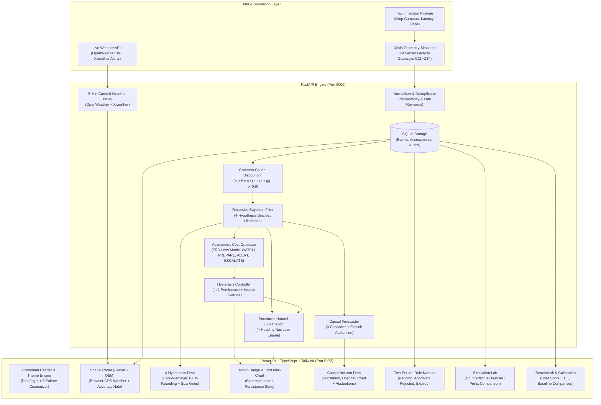

# FIRST 10 — Uncertainty-Aware Crisis Inference & Decision Engine

[](https://fastapi.tiangolo.com)
[](https://react.dev)
[](https://www.typescriptlang.org)
[](https://vitejs.dev)
[](https://tailwindcss.com)
[](https://docs.pytest.org)
[](https://www.w3.org/WAI/standards-guidelines/wcag/)

> **SIMULATED DATA — NOT FOR REAL EMERGENCY DECISIONS**  
> *FIRST 10 is an operational research and simulation decision-support prototype. Telemetry, incident events, and downstream actions are generated for evaluation and validation. It does not broadcast live sirens, SMS alerts, or municipal dispatches.*

---

## 1. Executive Summary

During the initial 10 minutes of an emerging urban crisis—such as a flash flood, cloudburst, or electrical grid failure—city duty officers face a flood of noisy, contradictory, and hardware-coupled sensor telemetry. Premature escalation causes public panic and millions in wasted mobilization costs; delayed escalation leads to catastrophic losses and preventable casualties.

**FIRST 10** is an uncertainty-aware decision engine that operates minute-by-minute to arbitrate between four competing hypotheses:
1. **Noise ($h_1$):** Random telemetry blips and transient anomalies.
2. **Sensor / Gateway Failure ($h_2$):** Correlated hardware failures or network drops.
3. **Isolated Incident ($h_3$):** Localized flooding or single-zone anomalies that do not spread.
4. **Cascading Crisis ($h_4$):** Systematic urban infrastructure propagation (drainage failure $\rightarrow$ substation trip $\rightarrow$ arterial road paralysis).

The system integrates recursive Bayesian filtering, common-cause gateway discounting, asymmetric cost matrix loss minimization, a $k=2$ persistence hysteresis controller, an abstaining causal forecaster, and a live spatial GPS radar.

---

## 2. System Architecture



---

## 3. Mathematical Foundations of the Engine

### 3.1 Recursive Bayesian Hypothesis Filter
At every minute $t \in [1, 15]$, the engine maintains a joint probability distribution over the discrete hypothesis set $\mathcal{H} = \{h_1, h_2, h_3, h_4\}$:
$$P(h_i \mid E_{1:t}) \propto P(h_i \mid E_{1:t-1}) \cdot \prod_{g \in \mathcal{G}} P(E_{t, g} \mid h_i)^{n_{\text{eff}}(g)}$$

To prevent fractional rounding inconsistencies in the user interface (e.g., $33\% + 33\% + 33\% = 99\%$), integer percentage representations strictly use the **Largest Remainder Method** (Hare-Niemeyer Algorithm) guaranteeing:
$$\sum_{i=1}^4 \text{RoundPct}(h_i) \equiv 100\% \quad \forall t$$

### 3.2 Gateway Common-Cause Discounting
A critical trap for naive anomaly detectors is treating multiple sensor failures from the same physical gateway as independent evidence of a municipal catastrophe. When gateway $g$ has $n$ active alerts, FIRST 10 calculates the effective independent witness count $n_{\text{eff}}$ with hardware correlation parameter $\rho = 0.8$:
$$n_{\text{eff}} = \frac{n}{1 + (n - 1)\rho}$$
- For $n = 10$ alerts on Gateway G-12: $n_{\text{eff}} = \frac{10}{1 + 9(0.8)} = \frac{10}{8.2} \approx 1.22$ independent witnesses.
- As a result, catastrophic hardware failure at a single junction is correctly identified as **Sensor Failure ($h_2$)** rather than triggering an emergency evacuation.

### 3.3 Asymmetric Cost Matrix Minimization
Actions $\mathcal{A} = \{\text{WATCH}, \text{PREPARE}, \text{ALERT}, \text{ESCALATE}\}$ are selected by minimizing the expected loss over the TRD consequence matrix:
$$\mathbb{E}[L(a)] = \sum_{i=1}^4 P(h_i) \cdot C[a, h_i]$$

| Action ($a$) | Noise ($h_1$) | Sensor Fail ($h_2$) | Isolated ($h_3$) | Cascade ($h_4$) |
|:---|:---:|:---:|:---:|:---:|
| **WATCH** | $0$ | $5$ | $40$ | $200$ |
| **PREPARE** | $5$ | $8$ | $15$ | $100$ |
| **ALERT** | $25$ | $30$ | $10$ | $40$ |
| **ESCALATE** | $120$ | $140$ | $50$ | $0$ |

### 3.4 Hysteresis Persistence Controller
To eliminate control thrashing and action chatter in high-stakes environments:
- **Escalation:** Can occur immediately if expected loss recommends higher escalation.
- **De-escalation:** Requires $k = 2$ consecutive minutes of persistent lower-loss recommendation before the system downgrades the operational posture.
- **Immediate Override:** If $P(h_4) > 0.40$ confirmed by $\ge 2$ independent gateways, the controller forces immediate escalation regardless of prior hysteresis state.

### 3.5 Causal Forecaster with Explicit Abstention
Tracks three sequential propagation milestones:
1. **$t + 4\text{m}$:** Substation Flashover & Grid Isolation
2. **$t + 7\text{m}$:** Hospital Drainage Sump Backflow
3. **$t + 9\text{m}$:** Arterial Highway Impassability

**Abstention Gate:** If camera or upstream telemetry from a critical sector is dropped or missing, the forecaster does not guess. It renders an explicit abstention state:
> *"Forecast unavailable: fewer than 2 independent supporting sources."*

---

## 4. Control-Room Design, Themes & Customization

The user interface follows the **Impeccable Control-Room** design language: zero emojis in operational displays, tabular numbers, 150ms transitions, 8px radius geometry, and dual-mode color tokens.

### 4.1 Dark & Light Theme Modes
- **Dark Operations Mode (Default):** Engineered for low-light 24/7 command centers. Uses charcoal-brown obsidian (`#0D0B0A`), raised tactile panels (`#17120F`, `#211A15`), subtle 1px geometric borders (`#33281F`), and cream typography (`#F5EFE8`).
- **Light Office/Projector Mode:** Engineered for sunlight-exposed offices, projector briefings, and PDF exports. Uses warm sand paper (`#F8F6F2`), clean white containers (`#FFFFFF`), and deep ink-brown typography (`#1E1B18`).

### 4.2 Six Operational Accent Palettes
Operators can switch between 6 distinct visual themes in both light and dark modes:
1. **Tactical Brown (Default):** Warm control-room palette (`#8B5E3C` / `#B07A4F`).
2. **Maritime Teal:** Coastal hydrology and floodgate management (`#0D9488` / `#2DD4BF`).
3. **Forest Emerald:** Environmental monitoring and watershed grids (`#059669` / `#34D399`).
4. **Civil Indigo:** Metropolitan disaster response and transit hubs (`#6366F1` / `#818CF8`).
5. **Industrial Amber:** Petrochemical, hazmat, and refinery operations (`#D97706` / `#FBBF24`).
6. **High-Alert Crimson:** Immediate catastrophic emergency escalation (`#DC2626` / `#F87171`).

### 4.3 Spatial Radar with Tactical Dark Filter
- Uses Leaflet + OpenStreetMap raster tiles (zero proprietary API keys required).
- In dark mode, applies an authentic military radar inversion matrix:
  ```css
  filter: brightness(0.7) invert(1) contrast(1.8) hue-rotate(180deg) saturate(0.3);
  ```
- In light mode, clears filters for crystal-clear geographical map rendering.
- Centers automatically on the operator's real coordinates via `navigator.geolocation.watchPosition` with an accuracy circle halo; falls back to Mumbai Disaster Management HQ (`19.0760° N, 72.8777° E`) if denied.

---

## 5. Live Weather Proxy & Resilience

Weather data is routed exclusively through secure backend proxy endpoints so that external API credentials are never exposed to the client browser:
- `GET /api/weather?lat=&lon=`: Retrieves real-time temperature, wind speed, humidity, and 3-hour precipitation forecasts via OpenWeather.
- `GET /api/weather/alerts?lat=&lon=`: Retrieves severe weather observations and meteorological warnings via Xweather.
- **5-Minute Cache:** In-memory caching minimizes external API traffic and rate-limiting.
- **Fail-Soft Architecture:** If external network calls time out or fail, the system renders an unobtrusive `"Live weather unavailable"` notification and maintains 100% operational functionality. Real data is tagged `[LIVE]` while simulated scenario telemetry is tagged `[SIMULATED]`.

---

## 6. Two-Person Rule Authorization System

Consequential actions (**ALERT** and **ESCALATE**) require human authorization via an interactive Kanban queue:
- **Columns:** **Pending**, **Approved**, **Rejected**, **Expired**.
- **Cryptographic Separation of Roles:** An operator who requests an escalation cannot approve their own ticket. The backend rejects self-approval with HTTP 403 (`two_person_rule`).
- **Audit Logging:** Every authorization, approval, rejection, and rationale is persisted in SQLite with cryptographic user IDs and timestamps.

---

## 7. Quickstart & Local Setup

### 7.1 Prerequisites
- **Python:** Version 3.11 or 3.12 installed.
- **Node.js:** Version 18+ or 20+ installed.
- **Git**

### 7.2 Backend Setup (FastAPI — Port 8000)

```powershell
# 1. Navigate to backend directory
cd backend

# 2. Create virtual environment & activate
python -m venv venv
.\venv\Scripts\Activate.ps1   # On Linux/macOS: source venv/bin/activate

# 3. Install backend dependencies
pip install -r requirements.txt

# 4. Copy environment configuration
copy .env.example .env        # On Linux/macOS: cp .env.example .env

# 5. Seed the database with demo users & scenario episodes
python -m app.seed

# 6. Start the FastAPI server
python -m uvicorn app.main:app --host 0.0.0.0 --port 8000 --reload
```
The API documentation is interactively accessible at **[http://localhost:8000/docs](http://localhost:8000/docs)**.

### 7.3 Frontend Setup (React + Vite — Port 5173)

```powershell
# 1. Navigate to frontend directory in a separate terminal
cd frontend

# 2. Install dependencies
npm install

# 3. Start development server
npm run dev -- --host 0.0.0.0 --port 5173
```
Open **[http://localhost:5173](http://localhost:5173)** in your browser.

---

## 8. Demo User Credentials & Role Matrix

The database is pre-seeded with four operational personas:

| Role | Name | Email | Password | Allowed Capabilities |
|:---|:---|:---|:---|:---|
| **Duty Officer** | Inspector Sarah Chen | `officer@demo.first10` | `password123` | Playback control, minute scrubbing, initiate action requests |
| **Dispatch Supervisor** | Capt. Marcus Vance | `supervisor@demo.first10` | `password123` | Authorize / reject pending actions (Two-Person Rule) |
| **Operations Director** | Director Elena Rostova| `admin@demo.first10` | `password123` | Full access, system overrides, configuration audits |
| **System Observer** | Tech Analyst James Kim | `analyst@demo.first10` | `password123` | Read-only observation, Simulation Lab, benchmark evaluation |

> **Pro Tip:** In the login window, click any of the 4 persona quick-fill buttons to log in instantly without typing.

---

## 9. Automated Verification & Test Suite

The test suite validates the 10 core invariant properties required by Section 8 of the FAST Implementation Plan:

```powershell
# Run the complete test suite from project root
backend\venv\Scripts\pytest.exe -v
```

### Verified Test Matrix (10/10 Passing)

| Test ID | Test Name | Property Verified | Result |
|:---|:---|:---|:---:|
| `test_1` | `test_belief_sums_to_one` | $\sum P(h_i) \equiv 1.0$ at every minute under all conditions | **PASSED** |
| `test_2` | `test_duplicate_events_idempotent` | Re-ingesting duplicate events yields zero state change | **PASSED** |
| `test_3` | `test_shuffled_arrival_identical_output` | Arrival order permutation produces identical state | **PASSED** |
| `test_4` | `test_same_seed_byte_identical` | Simulator reproducibility with identical pseudo-random seed | **PASSED** |
| `test_5` | `test_twin_prefix_equality` | Counterfactual twins share byte-identical prefix ($t \le 8$) | **PASSED** |
| `test_6` | `test_gateway_failure_no_escalate` | $n_{\text{eff}}$ prevents gateway disconnect from escalating to crisis | **PASSED** |
| `test_7` | `test_cascade_reaches_alert_or_escalate` | True cascade drives action to ALERT or ESCALATE by $t=10$ | **PASSED** |
| `test_8` | `test_cameras_dropped_forecast_abstains` | Forecast explicitly abstains when independent sensors are lost | **PASSED** |
| `test_9` | `test_retracted_event_stops_influencing` | Retracted events immediately cease influencing posterior beliefs | **PASSED** |
| `test_10` | `test_two_person_rule_enforced` | Requesters cannot approve their own authorization requests (HTTP 403) | **PASSED** |

---

## 10. Repository File Structure

```
c:\tenmins\
├── backend/
│   ├── app/
│   │   ├── __init__.py
│   │   ├── main.py          # FastAPI application, auth routes, weather proxies
│   │   ├── engine.py        # Core Bayesian filter, common-cause, loss, hysteresis
│   │   ├── sim.py           # 40-sensor crisis simulator & twin generator
│   │   ├── models.py        # Pydantic schemas for events, beliefs, actions, forecasts
│   │   ├── db.py            # SQLite schema initialization and query helpers
│   │   ├── seed.py          # Database seeder with 5 demo episodes & demo users
│   │   └── metrics.py       # Brier score, ECE calibration, baseline benchmarks
│   ├── tests/
│   │   └── test_first10.py  # 10 formal invariant verification tests
│   ├── .env.example         # Example environment template with proxy keys
│   └── requirements.txt     # Python dependencies
├── frontend/
│   ├── src/
│   │   ├── components/
│   │   │   ├── ActionBadge.tsx      # Expected loss chart, action indicator, request trigger
│   │   │   ├── AuthModal.tsx        # Request modal + 4-column authorization Kanban
│   │   │   ├── Banner.tsx           # Persistent SIMULATED DATA warning banner
│   │   │   ├── BeliefCard.tsx       # Hare-Niemeyer rounded card, sparklines, drawer link
│   │   │   ├── Drawer.tsx           # Slide-over drawer for evidence and source health
│   │   │   ├── EvidenceHealth.tsx   # Uncoupled source counts & gateway status chips
│   │   │   ├── ForecastCard.tsx     # 3-cascade horizon cards with abstention support
│   │   │   ├── LiveMap.tsx          # Leaflet GPS radar with dark inversion & gateway markers
│   │   │   ├── ThemeSelector.tsx    # Dropdown & toggle for Dark/Light & 6 palettes
│   │   │   ├── Timeline.tsx         # Recharts stacked area graph with action ribbon
│   │   │   ├── WeatherCard.tsx      # Live weather observations + severe weather alerts
│   │   │   └── WhyPanel.tsx         # 4-heading structured natural language explanation
│   │   ├── pages/
│   │   │   ├── Dashboard.tsx        # Duty Officer real-time operations console
│   │   │   ├── Lab.tsx              # Twin experiment A/B comparison & fault injection
│   │   │   ├── Login.tsx            # Persona-based authentication screen
│   │   │   └── Metrics.tsx          # Calibration curve & baseline benchmark comparisons
│   │   ├── lib/
│   │   │   ├── api.ts               # Typed client connecting to FastAPI
│   │   │   ├── types.ts             # Shared TypeScript domain interfaces
│   │   │   └── ThemeContext.tsx     # Theme and accent palette state provider
│   │   ├── index.css                # CSS variables, dark/light styles, Leaflet filters
│   │   └── main.tsx                 # React entry point and routing
│   ├── package.json                 # Frontend dependencies and scripts
│   ├── tailwind.config.js           # Semantic color extensions
│   └── tsconfig.json                # TypeScript compiler configuration
├── docs/                            # Comprehensive architectural and PRD/TRD specs
├── design.md                        # Impeccable control-room design system specification
└── README.md                        # Master production documentation
```

---

## 11. Operational Keyboard Shortcuts

The Duty Officer Dashboard features immediate keyboard controls:
- **`Space`:** Toggle simulation play / pause.
- **`J`:** Advance simulation by one minute ($t + 1$).
- **`K`:** Step backward by one minute ($t - 1$).
- **`Escape`:** Dismiss any open slide-over drawer or modal dialog.

---

## 12. Honest Limitations & Scenario Assumptions

1. **Synthetic Telemetry:** Telemetry feeds, sensor rates, and gateway failure profiles are modeled for decision evaluation and are not connected to municipal physical SCADA actuators.
2. **Cost Matrix Calibration:** Cost parameters ($C[a, h]$) represent scenario assumptions tailored to urban storm water and electrical substations; municipal deployments require joint stakeholder elicitation.
3. **No Direct Siren Activation:** In compliance with public safety engineering standards, FIRST 10 provides decision support and records auditable authorization workflows; it never broadcasts unvetted public sirens or push alerts.
